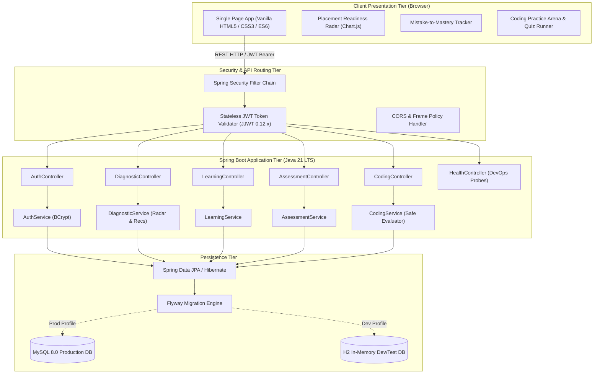

# DevPath — Architectural Design & System Documentation

## 1. System Vision & Core Principles
**DevPath** is a programming learning and placement preparation portal engineered to solve a fundamental deficiency in conventional learning management systems:
> *"Do not merely tell students what to learn. Identify what they struggle with, explain why they struggle, and guide them toward measurable improvement."*

The architecture separates diagnostic evaluation, personalized recommendation, and curricular progression into decoupled layers while packaging as a cloud-native, production-grade microservice.

---

## 2. High-Level Architecture Diagram

---

## 3. Layered Design Breakdown

### A. Presentation Layer (Vanilla Web)
- Pure standards-based **HTML5**, **CSS3**, and **Vanilla JavaScript** (ES6 modules).
- Zero heavy frontend framework dependencies (e.g. Node modules, React build steps), enabling instant demonstration by running the Java JAR or container directly.
- **Chart.js** client-side canvas rendering for dynamic 5-axis Placement Readiness Radar.

### B. Controller Layer (REST Endpoints)
- Standardized RESTful endpoints under `/api/*`.
- Declarative Bean Validation (`@Valid`, `@NotBlank`, `@Email`, `@Size`).
- Centralized exception mapping via `@RestControllerAdvice` (`GlobalExceptionHandler`).

### C. Security & Authorization Layer
- **Spring Security 6.x** stateless filter chain (`SecurityFilterChain`).
- BCrypt password hashing (never plaintext).
- JSON Web Tokens (JWT) signed with HMAC-SHA256 containing user identity and granted authorities (`ROLE_STUDENT`, `ROLE_ADMIN`).
- Role-based access control protecting administrative endpoints via `@PreAuthorize("hasRole('ADMIN')")`.

### D. Service & Diagnostics Layer
The distinctive algorithms powering DevPath:
1. **Placement Readiness Radar Engine**:
   $$\text{Category Score} = \left(\frac{\text{Correct Category Answers}}{\text{Total Category Questions Attempted}}\right) \times 100$$
   Computes separate competencies for:
   - Programming Fundamentals
   - Data Structures & Algorithms
   - Aptitude & Logical Reasoning
   - Computer Science Fundamentals
   - Technical Interview Preparation
2. **Adaptive Recommendation Engine**:
   Transparent, rule-based diagnostic analysis. Identifies topics where historical student accuracy is $< 65\%$. Looks up corresponding concept lessons and targeted coding challenges, attaching explicit diagnostic rationales (e.g., *"Recommended because your accuracy in 'Binary Trees' is 33%, below the 65% placement benchmark"*).
3. **Mistake-to-Mastery Classification**:
   Maps incorrect answers into discrete cognitive error buckets:
   - `CONCEPT_MISUNDERSTANDING`: Foundational gaps in theory or syntax mechanics.
   - `INCORRECT_LOGIC`: Flawed algorithmic deductions or flow control.
   - `BOUNDARY_CASE_ERROR`: Failure to guard edge cases (null, 0, overflow, off-by-one).
   - `SYNTAX_OR_TYPE_TRAP`: Language-specific traps (pass-by-value vs reference, idempotency).
   - `TIME_SPACE_INEFFICIENCY`: Suboptimal complexity choices.
4. **Proof of Progress Calculator**:
   $$\Delta_{\text{improvement}} = \text{Latest Score \%} - \text{Baseline Score \%}$$
   Computes exact percentage point gains over stored historical assessments without hardcoded demo mocks.

### E. Persistence Layer
- **Spring Data JPA** interfaces with Hibernate ORM.
- **Flyway** database migration scripts managing schema evolution versioning.
- Profile-based dual-driver configuration:
  - `dev`: Zero-setup in-memory/file H2 database.
  - `prod`: High-performance MySQL 8.0 with InnoDB engine and UTF-8 encoding.
