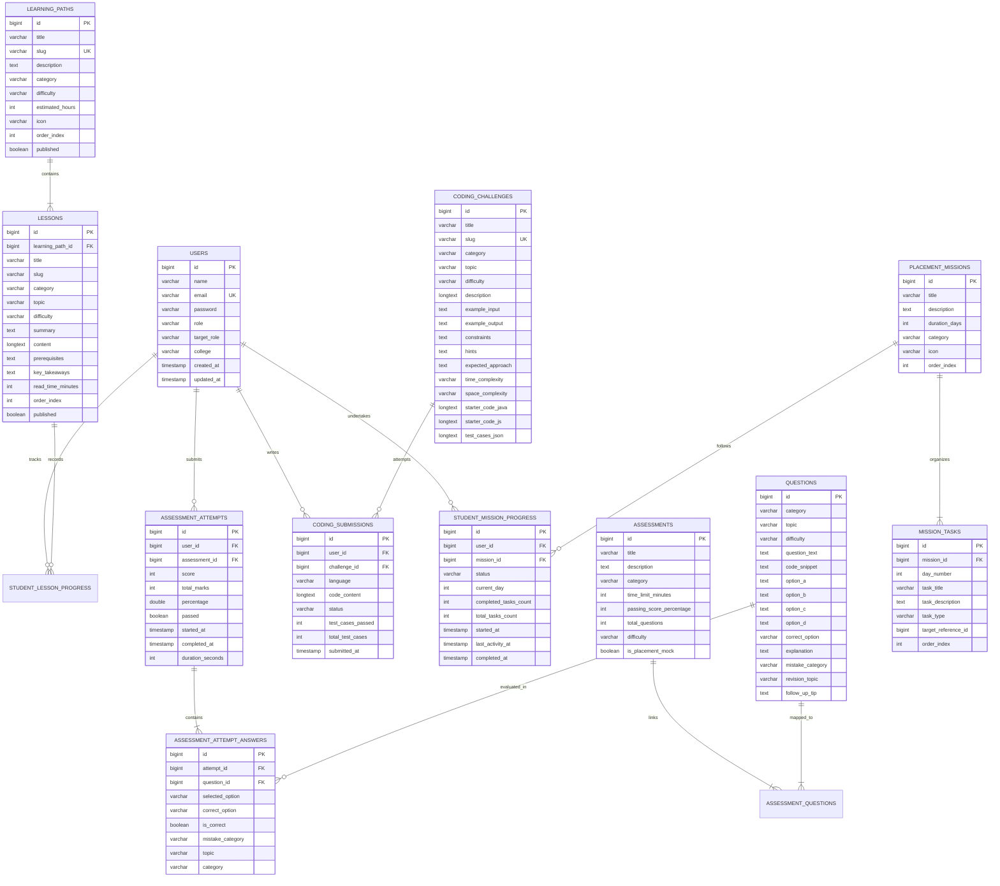

# DevPath — Database Schema & Entity Relationship Model

## 1. Entity Relationship (ER) Diagram

---

## 2. Table Definitions & Constraints

### `users`
| Column | Type | Constraints | Description |
|---|---|---|---|
| `id` | BIGINT | PRIMARY KEY, AUTO_INCREMENT | Unique user identifier |
| `name` | VARCHAR(100) | NOT NULL | Full name of the user |
| `email` | VARCHAR(120) | NOT NULL, UNIQUE | User login email address |
| `password` | VARCHAR(100) | NOT NULL | BCrypt hash of user password |
| `role` | VARCHAR(20) | NOT NULL, DEFAULT 'ROLE_STUDENT' | Security authority (`ROLE_STUDENT`, `ROLE_ADMIN`) |
| `target_role` | VARCHAR(100) | DEFAULT 'Software Engineer' | Student placement career target |
| `college` | VARCHAR(150) | NULL | Academic institution / department |
| `created_at` | TIMESTAMP | NOT NULL, DEFAULT CURRENT_TIMESTAMP | Registration timestamp |
| `updated_at` | TIMESTAMP | DEFAULT CURRENT_TIMESTAMP ON UPDATE CURRENT_TIMESTAMP | Last modification |

### `assessment_attempt_answers`
*Core diagnostic entity powering the Placement Readiness Radar and Mistake-to-Mastery Tracker.*
| Column | Type | Constraints | Description |
|---|---|---|---|
| `id` | BIGINT | PRIMARY KEY, AUTO_INCREMENT | Answer identifier |
| `attempt_id` | BIGINT | NOT NULL, FK &rarr; `assessment_attempts(id)` | Parent test attempt |
| `question_id` | BIGINT | NOT NULL, FK &rarr; `questions(id)` | Attempted question |
| `selected_option` | VARCHAR(5) | NULL | Option submitted by student ('A', 'B', 'C', 'D') |
| `correct_option` | VARCHAR(5) | NOT NULL | Verified answer option |
| `is_correct` | BOOLEAN | NOT NULL, DEFAULT FALSE | Automated grading flag |
| `mistake_category` | VARCHAR(50) | NULL | Diagnostic failure classification |
| `topic` | VARCHAR(100) | NULL | Granular subject topic |
| `category` | VARCHAR(50) | NULL | Broad radar competency category |
